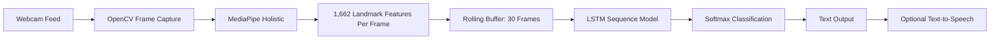

# 🩺 Real-Time Medical Sign Language Translator

> An edge-AI computer vision system that translates sign-language gestures into medical text prompts in real time.


---

## 📌 Overview

**Real-Time Medical Sign Language Translator** is an edge-AI accessibility project that recognizes selected sign-language gestures from a live webcam feed and converts them into text in real time.

The system is intended as a prototype assistive tool for deaf and hard-of-hearing users during medical video consultations, such as telehealth appointments. Rather than transmitting video to a cloud service, the model runs locally on the user’s computer, helping preserve privacy and reduce network dependence.

Unlike standard image-classification models that classify one static image at a time, this project treats gesture recognition as a **temporal sequence problem**. A sign is recognized from its movement across multiple frames, not just from one frame.

> [!IMPORTANT]
> This project is a research and educational prototype. It is **not** a certified medical device, professional sign-language interpreter, or substitute for qualified medical care or accessibility services.

---

## ✨ Key Features

- Real-time webcam-based gesture recognition.
- Local, edge-based inference without cloud video uploads.
- MediaPipe Holistic feature extraction.
- Extraction of **1,662 landmarks per frame**:
  - Pose landmarks.
  - Face landmarks.
  - Left-hand landmarks.
  - Right-hand landmarks.
- Rolling sequence buffer of 30 video frames.
- Deep-learning classification using an LSTM-based neural network.
- Softmax output for multiclass gesture prediction.
- Medical-oriented vocabulary for basic communication.
- Jupyter Notebook workflow for:
  - Data collection.
  - Preprocessing.
  - Model training.
  - Evaluation.
  - Live inference.
- Extensible vocabulary for future signs and symptoms.

---

## 🧠 Current Vocabulary

The initial trained model recognizes the following gestures:

| Gesture | Intended Meaning |
|---|---|
| `hello` | Greeting or requesting attention |
| `doctor` | Referring to a doctor or healthcare provider |
| `fever` | Indicating fever symptoms |
| `headache` | Indicating head pain or headache |
| `thanks` | Expressing gratitude |

> [!NOTE]
> The vocabulary is intentionally small for the prototype phase. Adding new signs requires collecting examples, retraining the model, and validating the updated model.

---

## 🏗️ System Architecture



### Processing Pipeline

```text
Live Webcam Feed
       │
       ▼
OpenCV Captures a Frame
       │
       ▼
MediaPipe Holistic Detects Body, Face, and Hand Landmarks
       │
       ▼
1,662 Landmark Features Are Extracted
       │
       ▼
30 Consecutive Frames Are Stored as a Motion Sequence
       │
       ▼
LSTM Learns the Gesture Movement Pattern
       │
       ▼
Softmax Layer Predicts the Most Likely Gesture
       │
       ▼
Recognized Gesture Is Displayed as Text
```

---

## 🔬 Why LSTM Instead of CNN?

A conventional CNN is excellent for recognizing objects in a single image, but many signs cannot be identified accurately from one frame alone.

For example, two gestures may have similar hand positions but differ in:

- Direction of movement.
- Speed of movement.
- Order of motion.
- Position changes over time.
- Interaction between hands, face, and body posture.

This project uses a **Long Short-Term Memory (LSTM)** neural network because it can learn patterns across time.

| Component | Purpose |
|---|---|
| OpenCV | Captures frames from the webcam |
| MediaPipe Holistic | Detects body, face, and hand landmarks |
| Landmark extraction | Converts visual input into numerical features |
| 30-frame sequence | Captures a gesture’s motion over time |
| LSTM network | Learns temporal motion patterns |
| Dense Softmax layer | Predicts the final gesture class |

---

## 🛠️ Technology Stack

| Category | Technology |
|---|---|
| Programming language | Python 3 |
| Deep learning | TensorFlow / Keras |
| Neural-network architecture | LSTM |
| Computer vision | OpenCV |
| Landmark extraction | Google MediaPipe Holistic |
| Data processing | NumPy |
| Dataset splitting and evaluation | Scikit-learn |
| Development environment | Jupyter Notebook |
| Optional environment manager | Conda |

---

## 📂 Suggested Project Structure

```text
Sign_Language_Translation_LSTM_Model/
│
├── Medical_Sign_Language_Translator.ipynb
├── medical_symptoms.keras
├── requirements.txt
├── README.md
│
├── MP_Data/
│   ├── hello/
│   │   ├── 0/
│   │   │   ├── 0.npy
│   │   │   ├── 1.npy
│   │   │   └── ...
│   │   ├── 1/
│   │   └── ...
│   │
│   ├── doctor/
│   ├── fever/
│   ├── headache/
│   └── thanks/
│
└── assets/
    ├── architecture.png
    ├── demo.gif
    └── confusion_matrix.png
```

### Important Files

| File or Folder | Purpose |
|---|---|
| `Medical_Sign_Language_Translator.ipynb` | Main notebook for data collection, training, evaluation, and inference |
| `medical_symptoms.keras` | Saved trained Keras model |
| `MP_Data/` | Landmark-sequence dataset |
| `requirements.txt` | Python package dependencies |
| `README.md` | Project documentation |

---

# ⚙️ Installation and Setup

## Prerequisites

Install the following before running the project:

- Python 3.9 recommended.
- Conda or Miniconda recommended.
- Webcam.
- Jupyter Notebook.
- Windows, Linux, or macOS.

> [!TIP]
> Use a virtual environment. TensorFlow, MediaPipe, and OpenCV can create package-version conflicts when installed globally.

---

## 1. Clone the Repository

```bash
git clone [https://github.com/sagarshigehalli38319-ops/Sign_Language_Translation_LSTM_Model.git](https://github.com/sagarshigehalli38319-ops/Sign_Language_Translation_LSTM_Model.git)
cd Sign_Language_Translation_LSTM_Model
```

---

## 2. Create and Activate a Virtual Environment

### Conda Method — Recommended

Create the environment:

```bash
conda create -n signlang python=3.9 -y
```

Activate it:

```bash
conda activate signlang
```

### Alternative: Python Virtual Environment

Create the environment:

```bash
python -m venv .venv
```

Activate on Windows PowerShell:

```powershell
.venv\Scripts\Activate.ps1
```

Activate on Windows Command Prompt:

```bat
.venv\Scripts\activate
```

Activate on Linux or macOS:

```bash
source .venv/bin/activate
```

---

## 3. Install Dependencies

If a `requirements.txt` file is available:

```bash
pip install -r requirements.txt
```

If it is not available, install the core packages manually:

```bash
pip install tensorflow opencv-python mediapipe numpy scikit-learn jupyter
```

### Example `requirements.txt`

```text
tensorflow
opencv-python
mediapipe
numpy
scikit-learn
jupyter
matplotlib
seaborn
```

> [!NOTE]
> Package compatibility can vary by Python version and operating system. If MediaPipe or TensorFlow installation fails, verify that your Python version is supported by the installed package versions.

---

## 4. Launch Jupyter Notebook

```bash
jupyter notebook
```

Open the main notebook:

```text
Medical_Sign_Language_Translator.ipynb
```

If `jupyter` is not recognized on Windows, try:

```bash
python -m notebook
```

---

# 🚦 How to Use the Notebook

The project notebook supports two different workflows:

1. **Inference only** — use the existing trained model to recognize gestures.
2. **Training from scratch** — collect your own sign data and retrain the model.

---

## Scenario A: Run the Live Camera Demo

Use this workflow if you already have the trained model file:

```text
medical_symptoms.keras
```

You do **not** need to collect data or retrain the model.

### Run Notebook Sections in This Order

#### Step 1 — Imports

Run the cells importing the required packages:

```python
import cv2
import numpy as np
import mediapipe as mp
from tensorflow.keras.models import load_model
```

#### Step 2 — Initialize MediaPipe Holistic

Run the cells defining:

```python
mp_holistic
mp_drawing
mediapipe_detection()
draw_styled_landmarks()
```

#### Step 3 — Extract Landmark Features

Run the cell containing:

```python
extract_keypoints(results)
```

This function converts MediaPipe results into one numerical feature array per frame.

#### Step 4 — Define the Vocabulary

Run the vocabulary cell:

```python
actions = np.array([
    'hello',
    'doctor',
    'fever',
    'headache',
    'thanks'
])
```

> [!IMPORTANT]
> The action order must match the order used while training the saved model. Changing the order without retraining causes incorrect label mapping.

#### Step 5 — Load the Trained Model

For inference, load the saved model:

```python
model = load_model('medical_symptoms.keras')
```

Do **not** rebuild a new `Sequential()` model if you are only testing the pre-trained weights.

#### Step 6 — Run Visualisation Utilities

Run the cells that define:

```python
colors
prob_viz()
```

These functions display class probability bars and predicted labels on the video frame.

#### Step 7 — Start the Webcam

Run the cell that contains:

```python
cap = cv2.VideoCapture(0)
```

A webcam window should open. Perform one of the supported signs clearly in front of the camera.

### Stop the Camera

Press:

```text
q
```

while the OpenCV video window is active.

> [!WARNING]
> If you only want live inference, do **not** run `model.fit()` or `model.save()`. Training a new model and saving it with the same filename can overwrite the working pre-trained model.

---

## Scenario B: Train the Model from Scratch

Use this workflow when you want to:

- Add new medical signs.
- Improve accuracy using more data.
- Train with your own gestures.
- Change the number of gesture classes.
- Replace the existing model.

---

### Step 1 — Run Setup and Landmark Functions

Run notebook sections that import libraries and define:

```python
mediapipe_detection()
draw_styled_landmarks()
extract_keypoints()
```

---

### Step 2 — Define the Vocabulary

Update the actions array with your required gestures:

```python
actions = np.array([
    'hello',
    'doctor',
    'fever',
    'headache',
    'thanks',
    'pain',
    'help'
])
```

> [!IMPORTANT]
> Every word added to `actions` must have training examples collected before you train the model.

---

### Step 3 — Create Dataset Folders

The notebook should create a folder structure similar to:

```text
MP_Data/
└── gesture_name/
    └── sequence_number/
        ├── 0.npy
        ├── 1.npy
        ├── ...
        └── 29.npy
```

Each gesture sample contains:

- 30 frames per sequence.
- One NumPy landmark file per frame.
- One folder per captured sequence.

Example data-collection configuration:

```python
DATA_PATH = os.path.join('MP_Data')
no_sequences = 30
sequence_length = 30
```

This means:

- `30` recorded sequences for each gesture.
- `30` frames stored in each sequence.

> [!TIP]
> For stronger generalization, collect more than 30 sequences per gesture. Include different lighting conditions, backgrounds, distances, clothing, and camera angles.

---

### Step 4 — Collect Training Data

Run the webcam collection cell.

For every gesture:

1. Read the on-screen instructions.
2. Position yourself clearly in front of the camera.
3. Perform the sign naturally.
4. Keep the sign visible in the webcam frame.
5. Allow the system to record all 30 frames.
6. Repeat for each requested sequence.

The notebook automatically saves landmark arrays to `MP_Data/`.

> [!NOTE]
> The raw camera video is not required for model training when the project stores only extracted landmarks. This lowers dataset size and can improve privacy compared with saving full video clips.

---

### Step 5 — Preprocess the Dataset

Run the preprocessing cells to:

- Read saved `.npy` landmark arrays.
- Convert each gesture name into a numeric label.
- Build the feature matrix `X`.
- Build the label matrix `y`.
- Split the dataset into training and testing sets.

Typical label mapping:

```python
label_map = {label: num for num, label in enumerate(actions)}
```

Typical dataset split:

```python
from sklearn.model_selection import train_test_split

X_train, X_test, y_train, y_test = train_test_split(
    sequences,
    labels,
    test_size=0.05
)
```

---

### Step 6 — Build the LSTM Architecture

A typical LSTM architecture for 30-frame landmark sequences may look like this:

```python
from tensorflow.keras.models import Sequential
from tensorflow.keras.layers import LSTM, Dense

model = Sequential()

model.add(LSTM(
    64,
    return_sequences=True,
    activation='tanh',
    input_shape=(30, 1662)
))

model.add(LSTM(
    128,
    return_sequences=True,
    activation='tanh'
))

model.add(LSTM(
    64,
    return_sequences=False,
    activation='tanh'
))

model.add(Dense(64, activation='relu'))
model.add(Dense(32, activation='relu'))
model.add(Dense(actions.shape, activation='softmax'))
```

Compile the model:

```python
from tensorflow.keras.optimizers import Adam

model.compile(
    optimizer=Adam(learning_rate=0.0005),
    loss='categorical_crossentropy',
    metrics=['categorical_accuracy']
)
```

### Architecture Summary

| Layer | Purpose |
|---|---|
| LSTM 1 | Learns short-term movement patterns |
| LSTM 2 | Learns deeper temporal relationships |
| LSTM 3 | Produces a compact sequence representation |
| Dense layers | Combine learned temporal features |
| Softmax output layer | Produces probabilities for each gesture class |

---

### Step 7 — Train the Model

Train the model:

```python
model.fit(
    X_train,
    y_train,
    epochs=500,
    validation_data=(X_test, y_test)
)
```

> [!TIP]
> Do not select the epoch count blindly. Watch the training and validation metrics. If training accuracy rises while validation accuracy becomes worse, the model may be overfitting.

---

### Step 8 — Save the Model

After training:

```python
model.save('medical_symptoms.keras')
```

This exports the trained model so it can be used later without retraining.

---

### Step 9 — Evaluate the Model

Evaluate test accuracy:

```python
loss, accuracy = model.evaluate(X_test, y_test)
print(f"Test accuracy: {accuracy:.2%}")
```

Generate predictions:

```python
yhat = model.predict(X_test)
```

For a meaningful evaluation, generate a confusion matrix to see which signs are most frequently confused.

```python
from sklearn.metrics import multilabel_confusion_matrix

ytrue = np.argmax(y_test, axis=1).tolist()
yhat = np.argmax(yhat, axis=1).tolist()

confusion_matrix = multilabel_confusion_matrix(ytrue, yhat)
print(confusion_matrix)
```

---

# 📊 Model Performance

The current model achieved **99%+ categorical accuracy on the project's test split**.

However, this result must be interpreted carefully:

- High test-split accuracy does not guarantee strong real-world performance.
- A small dataset can produce overly optimistic results.
- Training and test samples from the same person can make the task easier.
- Performance may decrease with different users, lighting, webcam positions, or signing styles.
- The model should be tested with users and settings not used during training.

> [!IMPORTANT]
> Do not describe the model as universally 99% accurate. A more accurate statement is:  
> **“The model achieved over 99% categorical accuracy on the current held-out test split.”**

---

# ⚙️ Engineering Notes

## Stable Gradient Training

LSTM networks can suffer from unstable gradients during long sequence training.

This project improved training stability by using:

- `tanh` activation for LSTM layers.
- Adam optimizer.
- Reduced learning rate:

```python
Adam(learning_rate=0.0005)
```

This configuration helped reduce unstable updates during iterative training.

---

## Edge Privacy

The inference pipeline runs locally:

```text
Webcam → OpenCV → MediaPipe → LSTM Model → Local Text Output
```

No webcam feed needs to be transmitted to a cloud server during normal local inference.

This design can offer advantages such as:

- Reduced network dependency.
- Lower latency.
- Better user control over local video data.
- Reduced exposure of sensitive visual information.

> [!NOTE]
> Privacy still depends on the complete application setup. Avoid recording video unnecessarily, avoid uploading datasets without consent, and secure any stored model or dataset files.

---

# 🐛 Troubleshooting

## Webcam Does Not Open

Try changing:

```python
cap = cv2.VideoCapture(0)
```

to:

```python
cap = cv2.VideoCapture(1)
```

If using Windows, try the DirectShow backend:

```python
cap = cv2.VideoCapture(0, cv2.CAP_DSHOW)
```

Also check:

- No other application is using the camera.
- Camera permissions are enabled.
- The correct camera index is selected.
- Your webcam drivers are installed.

---

## `jupyter` Is Not Recognized

Try:

```bash
python -m notebook
```

If needed, install Jupyter:

```bash
pip install notebook
```

---

## TensorFlow or MediaPipe Installation Fails

Check your Python version:

```bash
python --version
```

Python 3.9 is recommended for broad compatibility with many TensorFlow and MediaPipe setups.

Create a clean environment and reinstall:

```bash
conda create -n signlang python=3.9 -y
conda activate signlang
pip install tensorflow opencv-python mediapipe numpy scikit-learn jupyter
```

---

## Model Predicts the Wrong Gesture

Possible causes:

- The action order differs from the training action order.
- The wrong `.keras` model file is loaded.
- Lighting is very different from training conditions.
- Hands are not fully visible.
- The model was trained with too few samples.
- The signer differs significantly from the person used for training.
- Landmark detection is failing.

Recommended actions:

- Verify the `actions` array order.
- Collect more data.
- Test in varied environments.
- Use a probability threshold before accepting predictions.
- Add prediction smoothing across multiple frames.
- Retrain the model.

---

## Poor Real-Time Performance

Try:

- Close unnecessary applications.
- Reduce webcam resolution.
- Use a faster CPU.
- Use only pose and hand landmarks instead of face landmarks if facial landmarks are not necessary.
- Decrease the display resolution.
- Use a smaller LSTM model.
- Consider TensorFlow Lite for optimized deployment.

---

# 🔐 Privacy, Ethics, and Safety

This system involves sign-language interpretation and medical communication. It must be used responsibly.

## Recommended Practices

- Obtain consent before collecting sign-language training samples.
- Do not upload participant data without permission.
- Avoid storing raw video unless it is necessary.
- Secure the training dataset.
- Clearly communicate that the system may make recognition mistakes.
- Use human interpreters and professional medical support where required.
- Test with a diverse group of signers.
- Do not make medical decisions based only on this model’s output.

## Important Limitations

- This prototype recognizes only a limited predefined vocabulary.
- Sign languages have grammar, context, regional variations, and expressive elements not represented by isolated gesture labels.
- A sign-language translator should not be treated as a replacement for a qualified interpreter.
- The output may be incorrect under poor lighting, occlusion, fast motion, different signing styles, or incomplete hand visibility.
- Medical communication can be high-stakes; always provide a fallback communication method.

> [!CAUTION]
> Do not use this prototype as the only communication method in an emergency or critical medical situation.


## ⭐ Support

If you find this project useful, consider giving the repository a star.

Contributions, issues, feature suggestions, and feedback are welcome.
